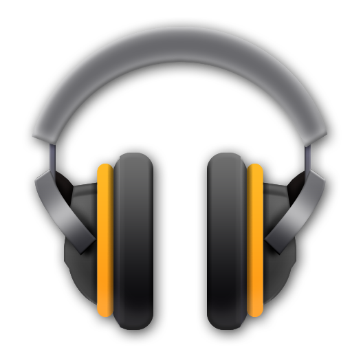

# 🎵 Music Player

  

Music Player is a React Native mobile application for browsing and playing locally stored music on Android and iOS devices. The app is designed as a local-first music library with a themed player sheet, search, metadata views, and playlist support.

## 🚀 Project status

This project is currently in an active development / prototype stage. A substantial portion of the UI and playback framework is implemented, but several screens and player features are intentionally incomplete or still under construction.

## ✨ Features and capabilities

### 1. Local music discovery and metadata ingestion
- Scans the device for local music files using `react-native-get-music-files-v3dev-test`.
- Loads metadata such as title, artist, album, duration, folder path, and artwork.
- Saves discovered music state in AsyncStorage so the app can reuse cached metadata between launches.
- Builds grouped collections for:
  - Tracks
  - Albums
  - Artists
  - Folders
- Supports a refresh/sync flow that reloads library data from storage.

### 2. Tabbed library browsing
- Includes a tabbed UI for browsing:
  - Playlists
  - Tracks
  - Albums
  - Artists
  - Folders
- Shows counters in the tab bar for library sections.
- Uses a responsive app bar and search entry points from the top navigation.

### 3. Search and discovery
- Search across local track metadata including title, album, artist, and folder path.
- Search results can include tracks, albums, artists, and folders.
- Search UI includes previous search handling and an app-level search experience.
- Search results can navigate to item detail views.

### 4. Playback engine
- Uses `react-native-track-player` for local audio playback.
- Supports the main playback controls: play, pause, stop, seek, previous track, next track, skip, jump forward/backward.
- Provides a now-playing player with:
  - track title and metadata
  - playback progress slider
  - play/pause state
  - next/previous availability
  - repeat-mode handling
  - playback speed controls
  - remaining time toggle
- Tracks can be queued and played in full or shuffled.
- The app includes a player bottom sheet with collapsible/minimized, expanded, and full-screen layouts.

### 5. Bottom sheet player experience
- Implements a custom animated bottom sheet player UI.
- Supports snapping to multiple heights: minimized, mid-size, and expanded.
- Includes custom handle and backdrop behavior.
- Allows navigation inside the bottom-sheet stack while keeping the player available.
- Supports opening the now-playing screen, current playlist screen, and item info screens from the sheet.

### 6. Queue and playlist management
- Maintains a current playlist concept and playlist view.
- Supports saving playlists to persistent storage.
- Supports playlist creation, rename/save workflows, deletion, and sorting.
- Tracks can be organized into playlists with track IDs.
- Playlist metadata includes creation and last-updated timestamps.

### 7. Music metadata/detail views
- Provides item detail screens for tracks, albums, artists, folders, and playlists.
- Shows details such as title, album, artist, duration, favorite state, playlist membership, and folder location.
- Uses custom artwork placeholders or music icons when no cover art is available.

### 8. Favorites and personalization
- Tracks favorite IDs in application storage.
- Shows favorite state in item detail screens.
- Favorites are wired into the app architecture, although the favorites tab itself is currently disabled in the main navigation.

### 9. Theme and app settings
- Includes a theme toggle for light and dark mode.
- Uses React Navigation and Paper themes for a consistent UI.
- Includes settings, app info, and about screens.
- Provides a search bar within settings and app info screens.

### 10. App infrastructure
- Uses React Native with Android and iOS project scaffolding.
- Includes permissions handling for storage access on Android.
- Uses custom constants, icons, styles, utility modules, and context providers for state management.
- Uses bottom sheet, navigation, gestures, and responsive-screen libraries to build the experience.

## ⚠️ Known limitations and current gaps

### Core product limitations
- Local-library-only playback: the app is built around local device files and does not offer cloud streaming, online library syncing, or remote music hosting.
- Android storage permissions are required and are enforced at startup; otherwise the app cannot load media metadata.
- The app does not currently support notification tray or lockscreen media controls in a fully complete way.
- Notification press to reopen the app is not implemented yet.
- Notification remote actions such as Like/Dislike/Rating are not fully implemented.
- The app does not include file-based logging or user-approved error telemetry.

### Playback limitations
- Album art detection is incomplete: track cover detection is unreliable for tracks that do not have embedded artwork.
- Remote and Android notification control support is partially implemented but still has unresolved bugs.
- Some player state synchronization issues remain, such as button state mismatches and queue/selection edge cases.
- Playback controls are not fully aligned with intended behavior in all scenarios, especially around play state, queue position, and track change events.
- The app currently does not implement full lockscreen playback UX similar to a major commercial music app.

### UI and screen completeness
- Several screens are placeholder or partially implemented:
  - Artists screen
  - Albums screen
  - Folders screen
  - About screen
- The Favorites tab is commented out and not active in the main navigation.
- Search is limited in scope and does not search playlists or app settings beyond the dedicated search screens.
- The app does not yet fully support playlist context actions across every screen.
- Some list interactions are still under construction, including drag-and-drop playlist reordering, multi-selection behaviors, and swipe actions.
- Full iOS polish and UX fixes are still pending.

### Playlist and sync limitations
- Playlist functionality is only partly implemented.
- Advanced playlist actions such as:
  - rearranging tracks,
  - multiple track selection,
  - multi-item context menus,
  - playlist synchronization,
  - per-playlist controls,
  are not complete.
- The library sync feature is planned but not fully built.
- Folder-level music loading/syncing is still incomplete.

### Visual and resilience gaps
- Some UI fixes are explicitly marked with TODO/FIXME comments, including:
  - theme consistency across all screens
  - responsiveness on rotation and multiple device sizes
  - scroll behavior in some list/detail views
  - corner clipping in playlist covers
  - empty-state and loader behavior for pagination/loading states
- Performance optimizations like `useMemo` and `useCallback` are still being applied in places.
- There is no dedicated error-reporting pipeline for end-user diagnostics.

## Explicit known issues recorded in the repository

1. Songs without album covers are not reliably detected.
2. The player cannot be controlled from the notification tray.
3. The app cannot open when pressing a notification because notification deep-linking / linking support is not implemented.
4. Some lists need load-more indicators and progressive loading states.
5. The project still has TODOs for playlist UI, sorting, favorites, and optimization work.

## 🛠️ Planned improvements and roadmap items

- Add notification deep linking (React Native Linking integration)
- Add like/dislike/rating capability support
- Add list-loading indicators for long result sets
- Add user-approved file logging and crash/error reporting
- Improve player controls and lockscreen behavior
- Finish screen implementations for artists, albums, favorites, and folders
- Complete playlist management actions and sync support
- Improve dark-mode coverage and responsiveness across devices
- Harden iOS experience and general UX polish
- Review and optimize performance with memoization and callback patterns

## 👥 Notes for contributors

This repository is structured as a React Native app with a modular architecture built around:
- navigation stacks
- music context state
- player utilities
- tracking and metadata utilities
- screen-level MVC-style components
- custom icon and theme helpers

The codebase is useful as a prototype and development playground for a local music player, but it should be treated as an evolving app rather than a finished production music platform.
